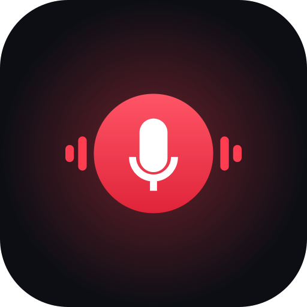
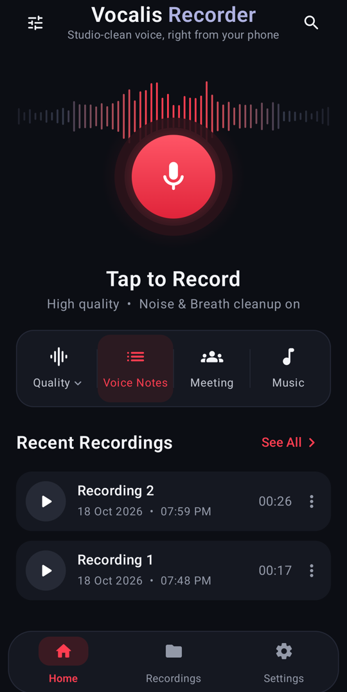
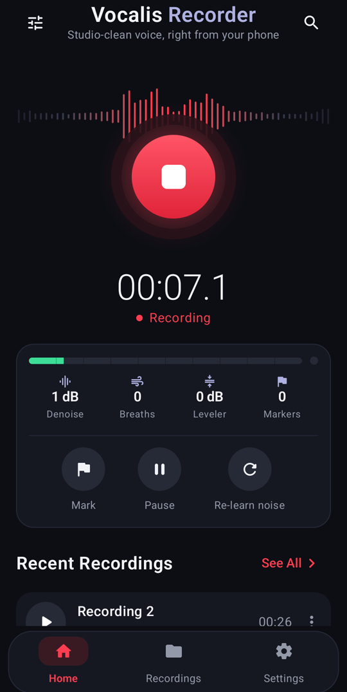
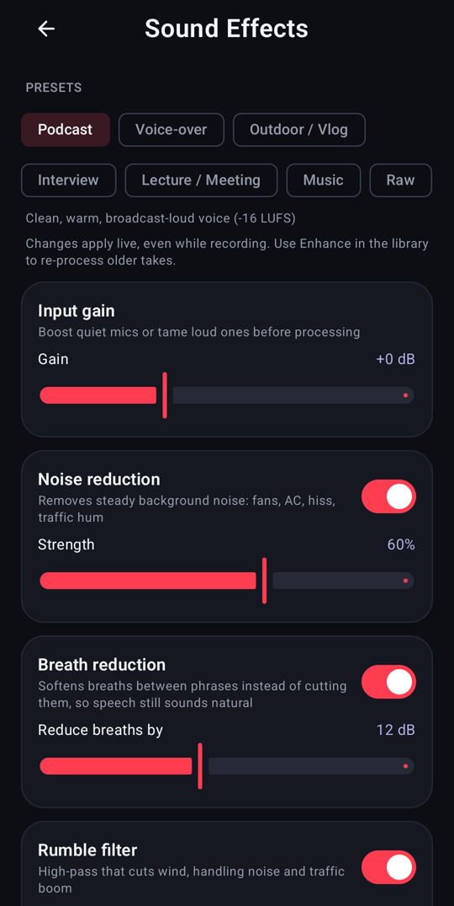
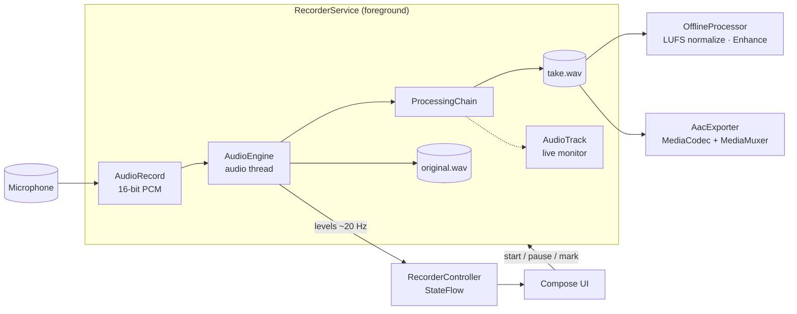

<p align="center">
  
</p>

<h1 align="center">Vocalis</h1>

<p align="center">
  <b>A studio-quality voice recorder for Android, with real-time noise and breath reduction.</b><br/>
  Kotlin · Jetpack Compose · hand-written DSP · no cloud, no ads, no tracking
</p>

<p align="center">
  
  
  
  
</p>

<p align="center">
  
  &nbsp;
  
  &nbsp;
  
</p>

---

## Why I built this

My phone doesn't come with a sound recorder at all, and the ones in app stores either record exactly what the microphone hears (fan hum, traffic, loud breaths, levels all over the place) or lock the useful parts behind a subscription.

Content creators, podcasters, students recording lectures and people doing interviews all hit the same problems:

| Problem | What Vocalis does about it |
|---|---|
| Background hum, fans, AC, hiss | **Spectral noise reduction** that learns the room in the first second and keeps adapting |
| Loud breaths between sentences | **Breath reduction** that detects breaths and turns them down by ~12 dB |
| Wind boom, desk thumps, handling noise | **Rumble filter** (24 dB/octave high-pass) |
| Voice sounds thin, boxy or muffled | **Voice EQ** for warmth, mud cut, presence and air |
| Harsh "s" sounds | **De-esser** |
| Some sentences too loud, others too quiet | **Compressor** |
| Clipping and distortion | **Look-ahead limiter** |
| "Why is my video quieter than everyone else's?" | **Loudness normalization** to -14 LUFS (YouTube/Spotify), -16 (podcasts) or -23 (broadcast) |

Everything runs **on the phone, in real time, while you record**. It's written from scratch in Kotlin with no native libraries, ML models or network access.

## Features

- **One-tap recording** with a live waveform, input meter and clip warning
- **Live readouts** showing how much noise is being removed, how many breaths were softened and how hard the compressor is working
- **Quick modes** (Voice Notes, Meeting, Music) plus full presets: Podcast, Voice-over, Outdoor / Vlog, Interview, Lecture, Music, Raw
- **Every effect is adjustable**, and changes apply live, even mid-recording
- **Keeps the original take** next to the processed one, with an **A/B switch** in the player
- **Enhance** re-processes old recordings with new settings without re-recording
- **Markers**: tap *Mark* while recording to flag a moment; markers show on the playback waveform
- **Records with the screen off** (foreground service with pause, resume and stop in the notification)
- **Crash-safe recording**: the WAV header is refreshed every 2 seconds, so a dead battery doesn't cost you the take
- **Lossless WAV** at 44.1 or 48 kHz, mono or stereo; **M4A (AAC) export** for uploading
- Search, rename, share, delete, and save to the shared *Music/Vocalis* folder
- Optional **live monitoring** through headphones

## How it works

### Architecture



- **`dsp/`** is pure Kotlin with **no Android dependencies**, so every processor is unit-tested on the JVM.
- **`audio/`** holds the real-time engine (`AudioRecord` on a high-priority thread), the foreground service, WAV I/O, offline rendering and AAC export.
- **`data/`** holds settings (SharedPreferences exposed as `StateFlow`) and the recordings library.
- **`ui/`** is Jetpack Compose, with one `AndroidViewModel` exposing `StateFlow`s and stateless screens.

The service and UI share state through a single `StateFlow` (`RecorderController`), so the UI survives being closed and reopened mid-recording.

### The processing chain

```text
input gain → rumble filter → noise reduction → breath reduction → gate → EQ → de-esser → compressor → limiter
                                                                         (after stop) → loudness normalization
```

Each stage is a small `AudioProcessor` that works in place on float buffers. The chain runs one independent strip per channel and can be reconfigured between buffers without losing filter state. That is what lets you move a slider while recording.

#### Noise reduction ([`SpectralDenoiser.kt`](app/src/main/java/com/vocalis/recorder/dsp/SpectralDenoiser.kt))

A streaming STFT (1024-point at 48 kHz, 75% overlap, sqrt-Hann windows, so about 21 ms of latency).

- **Noise estimate:** for each frequency bin, it averages the first 0.4 s of the take, then follows the minimum of the smoothed power with a slow rise. That way it adapts when an AC unit turns on but doesn't mistake speech for noise.
- **Suppression gain:** a decision-directed Wiener filter (Ephraim–Malah), the classic way to suppress noise without the warbly "musical noise" artefacts of plain spectral subtraction, plus a strength-dependent gain floor and light smoothing across frequency.

#### Breath reduction ([`BreathReducer.kt`](app/src/main/java/com/vocalis/recorder/dsp/BreathReducer.kt))

Noise reduction deliberately ignores breaths: they're short and the noise floor tracks slowly. The compressor actually makes breaths *louder*, because it lifts quiet parts. So breaths get their own detector, which checks four cues every ~5 ms:

1. **No pitch:** low normalized autocorrelation in the 80–400 Hz voice range (vowels are periodic, breath isn't).
2. **Noise-like:** high spectral flatness between 300 Hz and 6 kHz.
3. **Not a sibilant:** most energy below 4.5 kHz (an "s" lives above that).
4. **Quieter than speech:** at least 6 dB under the tracked speech level, but above the noise floor.

Short unvoiced consonants ("h", "f") match some of these cues, so a stretch only counts as a breath if it lasts **at least 120 ms**. A 125 ms look-ahead delay lets the gain start dropping right at the breath onset, with 15 ms fades. Breaths are turned *down*, not cut out, because perfectly silent gaps sound unnatural.

#### Loudness normalization ([`LoudnessMeter.kt`](app/src/main/java/com/vocalis/recorder/dsp/LoudnessMeter.kt))

A full ITU-R BS.1770-4 / EBU R128 implementation: K-weighting filters, 400 ms blocks with 75% overlap, an absolute gate at -70 LUFS and a relative gate at -10 LU. After you stop, the take is measured, gained to the target and passed through the limiter. Gain is capped at +24 dB so silence isn't turned into roaring noise.

## Testing & QA

```bash
./gradlew testDebugUnitTest          # 24 JVM tests (DSP, WAV I/O, presets)
./gradlew connectedDebugAndroidTest  # on-device: AAC export + Compose UI tests
./gradlew lintDebug                  # Android Lint (0 warnings)
```

**Unit tests** (JVM, run in about 10 s) feed **synthetic signals with known answers** through the DSP:

| Test | What it proves |
|---|---|
| `denoiserRemovesStationaryNoise` | ≥12 dB less white noise after the learning period |
| `denoiserPreservesToneLevel` | a voice-level tone in noise comes through within 1 dB |
| `softensBreathsButNotSpeechSibilantsOrShortConsonants` | a synthetic breath drops ≥8 dB while voiced speech (±0.5 dB), an "s" and a 60 ms "h" are untouched |
| `handlesLoudBreathInNoisyRoom` | same, with a louder breath and a 10× noisier room |
| `loudnessOfReferenceTone` | a 997 Hz sine at -20 dBFS measures -23.0 LUFS, the BS.1770 reference value |
| `wavRoundTripAndNormalization` | a file normalized to -16 LUFS re-measures at -16 ± 0.3 |
| `enhanceKeepsLengthAndAlignment` | offline processing compensates every look-ahead stage: the output is sample-for-sample the same length |
| `limiterNeverExceedsCeiling` | no sample over the ceiling, even with 5 dB of overload |
| `recordingInterruptedBeforeCloseIsStillReadable` | simulates a crash mid-recording; all 5 s are recovered |
| `readsFloatAnd24BitFiles` / `rejectsFilesThatAreNotWav` | WAV parser robustness |

**Instrumented tests** run on a real phone (tested on an HMD Crest, Android 14):

- `AacExporterTest` uses the phone's own AAC encoder and MP4 muxer, then checks the codec, sample rate, duration and strictly increasing timestamps.
- `HomeScreenTest` contains Compose UI tests: idle state, quick-mode presets, and the live controls while recording.

All 4 pass on the device (`am instrument`: `OK (4 tests)`).

**Manual QA on real hardware.** I recorded with the phone's own microphone, then ran each DSP stage in isolation on the untouched original take to check its real-world behaviour:

- Noise reduction changed speech by **0.0 dB**, so it never damages the voice. On this phone's *Voice* mic path the gaps were already at about −65 dBFS (the handset applies its own suppression), so there was little steady noise left, and the live meter correctly read ~0–1 dB. Pick *Unprocessed* in Settings to let Vocalis do all the cleanup.
- Breath reduction caught the one breath in the take and touched nothing else.

**CI:** every push runs the unit tests, lint and a build on GitHub Actions. The debug APK is attached to each run as an artifact.

### Bugs the tests and QA caught

- **Corrupt M4A exports.** Some devices' AAC encoders emit slightly out-of-order timestamps, which MP4 writers reject (`stop() err: -1007`), leaving a file with no audio track. Timestamps are now derived from the AAC frame count (1024 samples per frame), and an on-device test locks it in.
- **Slow export.** The encoder loop blocked for 10 ms on every output poll, so a 2-minute export took about 45 s. It now drains output without blocking and takes about 8 s.
- **Lost audio after a crash.** The WAV reader trusted a stale header size and dropped the last seconds of an interrupted take. Found by `recordingInterruptedBeforeCloseIsStillReadable`.
- **False breath detections in noisy rooms.** The noise-floor tracker started at -90 dB and rose too slowly, so plain room noise looked like "something above the floor". Found by `handlesLoudBreathInNoisyRoom`.
- **Record button moving under the thumb** when the recording controls appeared. Found in manual QA on an emulator.
- **Battery drain while idle.** Testing the minified release build showed the app using a full CPU core just sitting on the home screen: decorative animations redrew 60 times a second forever. The hero is now still when idle and animates only while recording, which took idle CPU from ~90% to 0% on the test device.
- **Clipped labels at large system font sizes** and a "-0 dB" readout. Found in manual QA on a real phone with enlarged fonts.
- **A UI test tapping a label instead of its button.** The test now targets the button's accessibility label, which is also what TalkBack users reach.

## Tech stack

| | |
|---|---|
| Language | Kotlin 2.0 |
| UI | Jetpack Compose, Material 3, custom Canvas drawing (waveforms, meters, record orb) |
| Architecture | Single-activity, `AndroidViewModel` + `StateFlow`, foreground `LifecycleService` |
| Audio I/O | `AudioRecord`, `AudioTrack`, `MediaCodec`, `MediaMuxer`, `MediaPlayer`, `android.media.audiofx` |
| DSP | Hand-written: radix-2 FFT, RBJ biquads, STFT denoiser, breath detector, dynamics, BS.1770 meter |
| Storage | App-specific external storage (no storage permission), `MediaStore` export, `FileProvider` sharing |
| Testing | JUnit 4, AndroidX Test, Compose UI Test |
| CI | GitHub Actions |
| Min / target SDK | 29 (Android 10) / 36 |

## Design decisions

- **Hand-written DSP instead of a library or ML model.** It keeps the APK at about 2 MB, works offline on cheap phones, adds no native code, and every stage is explainable and testable. An ML voice isolator (RNNoise, DeepFilterNet) is on the roadmap as an *optional* mode.
- **Record WAV, export AAC.** Lossless recording means re-processing ("Enhance") never stacks compression artefacts.
- **Keep the original take.** Processing can always be undone or redone, and A/B comparison shows what each effect is doing.
- **Normalize after recording, not during.** Integrated loudness needs the whole take; doing it live would mean guessing.
- **Turn breaths down rather than cut them.** Fully removing breaths makes speech sound robotic.
- **Dark-first UI.** It was designed for recording at night and in dim rooms, with large touch targets for one-handed use.

## Build it yourself

Requirements: **Android Studio** (or JDK 17 + Android SDK 36).

```bash
git clone https://github.com/sangit-pokhrel/SoundRecorder.git
cd SoundRecorder
./gradlew assembleDebug        # → app/build/outputs/apk/debug/app-debug.apk
./gradlew installDebug         # installs on a connected phone (USB debugging on)
```

Or grab the signed APK (~2.3 MB) from [Releases](https://github.com/sangit-pokhrel/SoundRecorder/releases). On your phone, allow "Install unknown apps" for your browser or file manager, then open the APK.

## Project structure

```text
app/src/main/java/com/vocalis/recorder/
├── dsp/            Pure-Kotlin DSP (no Android imports)
│   ├── Fft.kt, Biquad.kt                 building blocks
│   ├── SpectralDenoiser.kt               noise reduction
│   ├── BreathReducer.kt                  breath detection and softening
│   ├── Dynamics.kt                       high-pass, gate, EQ, de-esser, compressor, limiter
│   ├── LoudnessMeter.kt                  EBU R128 / LUFS
│   ├── ProcessingChain.kt                per-channel chain, live-reconfigurable
│   └── EffectSettings.kt                 settings + presets
├── audio/          AudioEngine, RecorderService, WAV I/O, OfflineProcessor, AacExporter
├── data/           SettingsRepository, RecordingRepository
└── ui/             Compose screens (Home, Recordings, Settings, Effects), components, theme
app/src/test/          JVM unit tests
app/src/androidTest/   on-device tests
```

## Roadmap

- [ ] Trim / cut editor using markers
- [ ] Echo and reverb reduction (dereverberation)
- [ ] Optional ML voice isolation (RNNoise / DeepFilterNet via ONNX Runtime)
- [ ] Home-screen widget and quick-settings tile for one-tap recording
- [ ] Transcription with on-device speech recognition
- [ ] iOS version (Compose Multiplatform UI + AVAudioEngine audio layer)

## Contributing

Issues and pull requests are welcome. Please run `./gradlew testDebugUnitTest lintDebug` before opening a PR, and add a test for any DSP change: if it changes the sound, it should change a number in a test.

## License

[MIT](LICENSE) © 2026 Sangit Pokhrel
